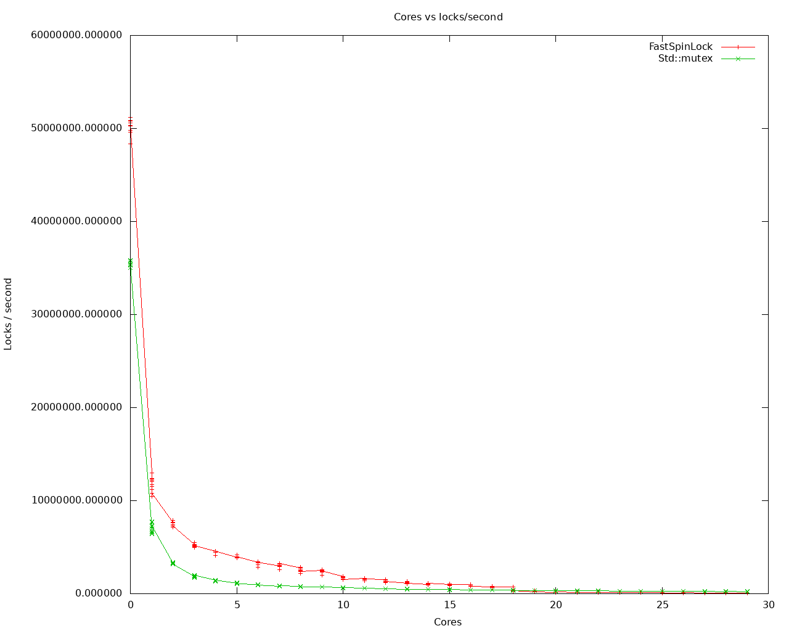
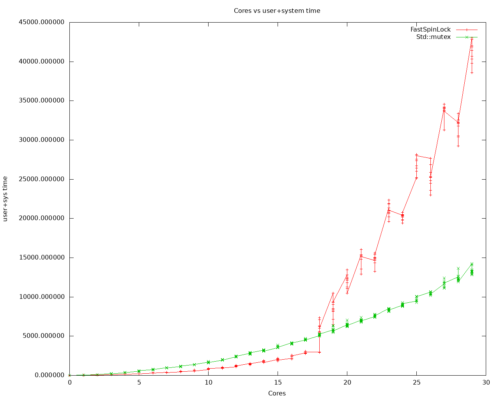

# FastSpinLock

FastSpinLock is a minimal, header‑only C++ spinlock implemented using a single
`std::atomic<bool>` and a test‑and‑set acquire loop. It is designed for cases
where extremely low uncontended latency is required and where the user
understands the tradeoffs of a pure TAS spinlock under contention.

FastSpinLock has:

- zero dependencies
- zero kernel involvement
- no futex fallback
- no fairness guarantees
- a fast uncontended path
- predictable behavior for micro‑critical sections
- a BSD 2-clause license

This project includes:

- the header‑only lock implementation (`FastSpinLock.hpp`)
- a benchmark directory (`benchmark/`), that compares FastSpinLock against `std::mutex` from 0-29 worker threads
  (1-30 total threads including main).  Gnuplot scripts (and png files) associated with a run on a
  CentOS 7 40-core 3.1 GHZ single-socket CPU and their input CSV files and output PNG files are attached in the repo.  `bench64\`
  and `bench128\` are identical to `benchmark\`, except that they are modified to use alignas(64) and alignas(128), respectively.
- Unit tests (`tests/`) covering `std::lock_guard`, `std::unique_lock`, `std::conditional_variable_any`, and `try_lock()`.
  Optional CMake flags (mutually exclusive): `-DCOVERAGE=ON` (gcov/lcov report via `coverage` target),
  `-DASAN=ON` (AddressSanitizer via `asan` target), `-DTSAN=ON` (ThreadSanitizer via `tsan` target),
  `-DUBSAN=ON` (UndefinedBehaviorSanitizer via `ubsan` target).

---

## Quick Start

```cpp
#include "FastSpinLock.hpp"

FastSpinLock mtx;

void example() {
    std::lock_guard<FastSpinLock> lock(mtx);
    // critical section
}
```

## Design Rationale

`std::mutex` is implemented (on Linux) on top of futex().  It's good, it's stable, it's not particularly performant.  I've ended
up writing high performance replacements at three different companies, from scratch (because they were done on company resources
and time).  For lower thread-count, a much more efficient solution exists, since we don't have to worry about "contention forever"
cases.  This is an open source equivalent that takes into consideration my multi-core, NUMA aware work, up to 4096 cores over
decades of programming.

This code is actually the completion of the code that I wrote on my own time, that I made available to those three companies.
This code adds try_lock, unit tests, and formalizes the benchmarks, over what was copied and used at those companies.

The idea is, that well designed code should have mutexes around small numbers of threads, with them being held for limited
amounts of time.  This implementation is optimized for that case.  `std::mutex` is implemented for the generic "do no harm" case.

## Compatibility

This class is a direct drop in for `std::mutex`, with one exception - `std::condition_variable` is not compatible.  If you want to
use this, use `std::condition_variable_any` instead.

## Where it should be used instead of std::mutex

This class is designed to have the least overhead possible with the basic rule that locks should be held for very short periods
of time, and a thread should never get descheduled in a lock state (such as doing a message to the systemd-journald logs, or to
disk files).

This is designed for typical use cases where there are a relatively small number of threads that share a mutex.  For example, an
MPMC queue with 16 or fewer threads that can own the lock get better performance than `std::mutex`, at significantly lower CPU
time (user+system).  At 18-threads, that flips.

If more threads exist than cores, `std::mutex` will probably be the way to go, because this doesn't deschedule to prevent
CPU thrashing.

It also doesn't protect against lock(A) ; lock(B) in one thread, and lock(B) and lock(A) in another.  I don't believe `std::mutex`
protects against this case either.

### Performance summary

| Threads | FastSpinLock | std::mutex |
| ------- | ------------ | ---------- |
| 1-9     | Faster       | Slower     |
| 10-17   | Comparable   | Comparable |
| 18+     | Slower       | Faster     |
Pass 10 (mylock)

## Header‑Only Lock

```cpp
class FastSpinLock {
public:
    FastSpinLock() {
        m_lock = false;
    }
    void lock() {
        while (std::atomic_exchange_explicit(&m_lock, true,
                                             std::memory_order_acquire))
            ;
    }
    void unlock() {
        std::atomic_store_explicit(&m_lock, false,
                                   std::memory_order_release);
    }
    bool try_lock() {
        return !std::atomic_exchange_explicit(&m_lock, true, std::memory_order_acquire);
    }
private:
    std::atomic<bool> m_lock;
};
```

## When to Use

FastSpinLock is appropriate when:

- the critical section is only a few instructions;
- the contention is expected to be low;
- the lock is used in tight loops when `std::mutex` overhead dominates;
- you want predictable, minimal overhead in the uncontended case.

## When Not to Use

FastSpinLock should not be used when:

- contention is high;
- fairness is required;
- threads may block for long periods;
- the critical section performs I/O or system calls;
- you need priority inheritance or wakeup ordering guarantees

Under contention, a TAS spinlock will generate cacheline ping-pong and degrade rapidly (which you will see for the larger core
counts in the graphs).  This is expected and inherent to the design.

## Notes, from experience

If you have lots of threads and each locks the same mutex, you should consider fixing your design.

### Example 1

If you use std::lock_guard and do logs or system calls within the lock state, you should consider your code, and narrow the
scope of the locks (with a more limited open/close bracing protection of the lock).

```cpp
{
    std::lock_guard(std::mutex) lock;
    // access protected data
    // then write data to disk
}
```

Is better represented by

```cpp
{
    std::vector<uint8_t> copy;
    {
        std::lock_guard(std::mutex) lock;
        // access protected data
        // copy protected data to "copy"
    }
    // then write data to disk
}
```

This is an example of how to reduce lock state with `std::mutex`.  FastSpinLock would get the same benefit.

### Example 2

I once worked at a company that did geolocation of cellular data at the eNodeB (LTE) layer - each eNodeB had one thread, so in
typical use cases, a server supported about 800 eNodeB's, so we had 800 threads with data.  Each thread pushed to a single queue
the data it read from cell phones.  The queue had a mutex.  On a 32-core server, you had about a 1/32 chance of getting a lock
(about 3%) to push to the queue.  It worked OK, but was slow.  When we deployed on a 96 core server, you had a 1/96 chance of
getting the lock (about 1%).  Performance was less than acceptable.  Crappy design.  The queue simply aggregated data from the
sources.

We were actually able to get this to be lock-free - we used TLS.  Each thread appended to a buffer, when the buffer filled,
we output to a socket (which was what the old queue did on the receiving side - one buffer, not one buffer per eNodeB).  This
change gave screaming good performance.

So the key here, if you can get rid of a mutex via smart programming, do that before switching to FastSpinLock (note,
FastSpinLock would not have worked here (we tried something similar) because of the huge number of threads doing locks).

## Benchmark results

This first plot compares locks/second for FastSpinLock and `std::mutex`.  The FastSpinLock values correspond to FastSpinLock in the
graphs.  `std::mutex` labels correspond to the `std::mutex` values in the graphs.

The tests run with main always doing lock/unlock, and a number of threads from 0 through 29.  The X axis is the number of
threads, so the values at 0 actually have a main process and zero threads doing locks/unlocks, and the value at 29 has main and
29 other threads doing locks and unlocks.

Each test does 10 tests each for each of FastSpinLock and `std::mutex` at each number of threads.

In this plot, the larger numbers along the Y axis are best.



And the second takes the cumulative CPU time of the threads (including the clock_gettime() calls around the lock/unlock calls
and the loop overhead).

In this plot, the smaller numbers on the Y axis are best.  Note that the degradation of `std::mutex` is linear, and, when FastSpinLock flips from better to worse (18 total threads),
it fails catastrophically.



### Benchmarking with alignas(64) and alignas(128)

The same benchmark plotted in the two plots was run with both Mutex classes being set as **alignas(64)** and **alignas(128)**,
since both are valid cache line sizes.  Like above, the test ran 10 iterations for each of FastSpinLock and `std::mutex`, for 0
through 29 threads (plus the main program).  The following table shows the results for no-align, 64-bit align, and 128-bit
align, for lock rate and sum(user+system) averaged.

We also measured the effect of `alignas(64)` and `alignas(128)`.  The results showed a consistent performance cost on the
uncontended and lightly-contended paths that matter most for this lock, so the shipped version remains unaligned.
Full numbers are available in [alignment-results.md](alignment-results.md).

For the percent values, +/- 5% is left in black.  If it's worse outside that range, it's in red.

If it's better outside that range, it's in green.

Notice that for Locks/second, the optimal point in the data is at 7 threads (main + 7 threads), where we see 3.6 times the number of locks/second than we do with `std::mutex`.
And for user+system time (CPU time) we see 38.6% of the CPU time for FastSpinLock in this case over `std::mutex`.  Another thing to note, that for FastSpinLock, there is
near-zero (zero for when we FastSpinLock is better than `std::mutex`) System time, whereas with `std::mutex`, most of the time is system time, so, FastSpinLock has zero context
switch overhead (which doesn't show up in a program's CPU time numbers).  Note that the color of alignas(64) User+System time has a bug - it shows up as black, not red, for
19+ cores (and main).  This will be fixed in a future commit.

A <a href="docs/alignment-results.md" target="_blank">More detailed table</a> that includes the `alignas` can be found at this link.

<table>
    <thead>
        <!-- Row 1 -->
        <tr>
            <th style="text-align:center; font-weight:bold;">Threads</th>
            <th colspan="2" style="text-align:center; font-weight:bold;">std::mutex</th>
            <th colspan="2" style="text-align:center; font-weight:bold;">FastSpinLock</th>
        </tr>
        <!-- Row 2 -->
        <tr>
            <th></th>
            <th colspan="1" style="text-align:center; font-weight:bold;">Locks/Second</th>
            <th colspan="1" style="text-align:center; font-weight:bold;">User+System Time</th>
            <th colspan="1" style="text-align:center; font-weight:bold;">Locks/Second</th>
            <th colspan="1" style="text-align:center; font-weight:bold;">User+System Time</th>
        </tr>
        <!-- Row 3 -->
        <tr>
            <th></th>
            <th colspan="1" style="text-align:center;">Locks/Second As a Percent<br/>(Greater Than 100% is best)</th>
            <th colspan="1" style="text-align:center;">User+System Time As a Percent<br/>(Less Than 100% is best)</th>
            <th colspan="1" style="text-align:center;">Locks/Second As a Percent<br/>(Greater Than 100% is best)</th>
            <th colspan="1" style="text-align:center;">User+System Time As a Percent<br/>(Less Than 100% is best)</th>
        </tr>
        <!-- Row 4 -->
        <tr>
            <th></th>
            <th style="text-align:center;"></th>
            <th style="text-align:center;">Percent</th>
            <th style="text-align:center;">Percent</th>
            <th style="text-align:center;">Percent</th>
        </tr>
    </thead>
    <tbody>
        <!-- Replace starting at the next line -->
	<tr>
	    <!-- Threads -->
	        <td style="text-align: right;"><span style="font-weight:bold;"> 0</span></td>
	    <!-- Mutex Locks / Second -->
	        <td style="text-align: right;"><span style="font-weight:bold;"> 35414052.507</span></td>
	    <!-- Mutex User+System -->
	        <td style="text-align: right;"><span style="font-weight:bold;"> 4.396</span></td>
	    <!-- FastSpinLock Locks / Second -->
	        <td style="text-align: right;"><span style="font-weight:bold;"> 50239938.956</span></td>
	    <!-- FastSpinLock User+System -->
	        <td style="text-align: right;"><span style="font-weight:bold;"> 3.569</span></td>
	</tr>
	<tr>
	    <!-- Threads -->
	        <td style="text-align: right;"><span >pct</span></td>
	    <!-- Mutex Locks / Second -->
	        <td style="text-align: right;"><span ></span></td>
	    <!-- Mutex User+System -->
	        <td style="text-align: right;"><span ></span></td>
	    <!-- FastSpinLock Locks / Second -->
	        <td style="text-align: right;"><span style="color: rgb(0,255,0);"> 141.864 🟢</span></td>
	    <!-- FastSpinLock User+System -->
	        <td style="text-align: right;"><span style="color: rgb(0,255,0);"> 81.187 🟢</span></td>
	</tr>
	<tr>
	    <!-- Threads -->
	        <td style="text-align: right;"><span style="font-weight:bold;"> 1</span></td>
	    <!-- Mutex Locks / Second -->
	        <td style="text-align: right;"><span style="font-weight:bold;"> 6990012.858</span></td>
	    <!-- Mutex User+System -->
	        <td style="text-align: right;"><span style="font-weight:bold;"> 37.619</span></td>
	    <!-- FastSpinLock Locks / Second -->
	        <td style="text-align: right;"><span style="font-weight:bold;"> 11759434.207</span></td>
	    <!-- FastSpinLock User+System -->
	        <td style="text-align: right;"><span style="font-weight:bold;"> 26.474</span></td>
	</tr>
	<tr>
	    <!-- Threads -->
	        <td style="text-align: right;"><span >pct</span></td>
	    <!-- Mutex Locks / Second -->
	        <td style="text-align: right;"><span ></span></td>
	    <!-- Mutex User+System -->
	        <td style="text-align: right;"><span ></span></td>
	    <!-- FastSpinLock Locks / Second -->
	        <td style="text-align: right;"><span style="color: rgb(0,255,0);"> 168.232 🟢</span></td>
	    <!-- FastSpinLock User+System -->
	        <td style="text-align: right;"><span style="color: rgb(0,255,0);"> 70.374 🟢</span></td>
	</tr>
	<tr>
	    <!-- Threads -->
	        <td style="text-align: right;"><span style="font-weight:bold;"> 2</span></td>
	    <!-- Mutex Locks / Second -->
	        <td style="text-align: right;"><span style="font-weight:bold;"> 3272492.196</span></td>
	    <!-- Mutex User+System -->
	        <td style="text-align: right;"><span style="font-weight:bold;"> 102.538</span></td>
	    <!-- FastSpinLock Locks / Second -->
	        <td style="text-align: right;"><span style="font-weight:bold;"> 7502863.296</span></td>
	    <!-- FastSpinLock User+System -->
	        <td style="text-align: right;"><span style="font-weight:bold;"> 59.608</span></td>
	</tr>
	<tr>
	    <!-- Threads -->
	        <td style="text-align: right;"><span >pct</span></td>
	    <!-- Mutex Locks / Second -->
	        <td style="text-align: right;"><span ></span></td>
	    <!-- Mutex User+System -->
	        <td style="text-align: right;"><span ></span></td>
	    <!-- FastSpinLock Locks / Second -->
	        <td style="text-align: right;"><span style="color: rgb(0,255,0);"> 229.271 🟢</span></td>
	    <!-- FastSpinLock User+System -->
	        <td style="text-align: right;"><span style="color: rgb(0,255,0);"> 58.133 🟢</span></td>
	</tr>
	<tr>
	    <!-- Threads -->
	        <td style="text-align: right;"><span style="font-weight:bold;"> 3</span></td>
	    <!-- Mutex Locks / Second -->
	        <td style="text-align: right;"><span style="font-weight:bold;"> 1885010.299</span></td>
	    <!-- Mutex User+System -->
	        <td style="text-align: right;"><span style="font-weight:bold;"> 225.943</span></td>
	    <!-- FastSpinLock Locks / Second -->
	        <td style="text-align: right;"><span style="font-weight:bold;"> 5164591.796</span></td>
	    <!-- FastSpinLock User+System -->
	        <td style="text-align: right;"><span style="font-weight:bold;"> 113.780</span></td>
	</tr>
	<tr>
	    <!-- Threads -->
	        <td style="text-align: right;"><span >pct</span></td>
	    <!-- Mutex Locks / Second -->
	        <td style="text-align: right;"><span ></span></td>
	    <!-- Mutex User+System -->
	        <td style="text-align: right;"><span ></span></td>
	    <!-- FastSpinLock Locks / Second -->
	        <td style="text-align: right;"><span style="color: rgb(0,255,0);"> 273.982 🟢</span></td>
	    <!-- FastSpinLock User+System -->
	        <td style="text-align: right;"><span style="color: rgb(0,255,0);"> 50.358 🟢</span></td>
	</tr>
	<tr>
	    <!-- Threads -->
	        <td style="text-align: right;"><span style="font-weight:bold;"> 4</span></td>
	    <!-- Mutex Locks / Second -->
	        <td style="text-align: right;"><span style="font-weight:bold;"> 1417964.998</span></td>
	    <!-- Mutex User+System -->
	        <td style="text-align: right;"><span style="font-weight:bold;"> 366.041</span></td>
	    <!-- FastSpinLock Locks / Second -->
	        <td style="text-align: right;"><span style="font-weight:bold;"> 4458619.622</span></td>
	    <!-- FastSpinLock User+System -->
	        <td style="text-align: right;"><span style="font-weight:bold;"> 158.810</span></td>
	</tr>
	<tr>
	    <!-- Threads -->
	        <td style="text-align: right;"><span >pct</span></td>
	    <!-- Mutex Locks / Second -->
	        <td style="text-align: right;"><span ></span></td>
	    <!-- Mutex User+System -->
	        <td style="text-align: right;"><span ></span></td>
	    <!-- FastSpinLock Locks / Second -->
	        <td style="text-align: right;"><span style="color: rgb(0,255,0);"> 314.438 🟢</span></td>
	    <!-- FastSpinLock User+System -->
	        <td style="text-align: right;"><span style="color: rgb(0,255,0);"> 43.386 🟢</span></td>
	</tr>
	<tr>
	    <!-- Threads -->
	        <td style="text-align: right;"><span style="font-weight:bold;"> 5</span></td>
	    <!-- Mutex Locks / Second -->
	        <td style="text-align: right;"><span style="font-weight:bold;"> 1138799.643</span></td>
	    <!-- Mutex User+System -->
	        <td style="text-align: right;"><span style="font-weight:bold;"> 537.703</span></td>
	    <!-- FastSpinLock Locks / Second -->
	        <td style="text-align: right;"><span style="font-weight:bold;"> 3939322.394</span></td>
	    <!-- FastSpinLock User+System -->
	        <td style="text-align: right;"><span style="font-weight:bold;"> 211.964</span></td>
	</tr>
	<tr>
	    <!-- Threads -->
	        <td style="text-align: right;"><span >pct</span></td>
	    <!-- Mutex Locks / Second -->
	        <td style="text-align: right;"><span ></span></td>
	    <!-- Mutex User+System -->
	        <td style="text-align: right;"><span ></span></td>
	    <!-- FastSpinLock Locks / Second -->
	        <td style="text-align: right;"><span style="color: rgb(0,255,0);"> 345.919 🟢</span></td>
	    <!-- FastSpinLock User+System -->
	        <td style="text-align: right;"><span style="color: rgb(0,255,0);"> 39.420 🟢</span></td>
	</tr>
	<tr>
	    <!-- Threads -->
	        <td style="text-align: right;"><span style="font-weight:bold;"> 6</span></td>
	    <!-- Mutex Locks / Second -->
	        <td style="text-align: right;"><span style="font-weight:bold;"> 945769.780</span></td>
	    <!-- Mutex User+System -->
	        <td style="text-align: right;"><span style="font-weight:bold;"> 746.572</span></td>
	    <!-- FastSpinLock Locks / Second -->
	        <td style="text-align: right;"><span style="font-weight:bold;"> 3325069.884</span></td>
	    <!-- FastSpinLock User+System -->
	        <td style="text-align: right;"><span style="font-weight:bold;"> 290.690</span></td>
	</tr>
	<tr>
	    <!-- Threads -->
	        <td style="text-align: right;"><span >pct</span></td>
	    <!-- Mutex Locks / Second -->
	        <td style="text-align: right;"><span ></span></td>
	    <!-- Mutex User+System -->
	        <td style="text-align: right;"><span ></span></td>
	    <!-- FastSpinLock Locks / Second -->
	        <td style="text-align: right;"><span style="color: rgb(0,255,0);"> 351.573 🟢</span></td>
	    <!-- FastSpinLock User+System -->
	        <td style="text-align: right;"><span style="color: rgb(0,255,0);"> 38.937 🟢</span></td>
	</tr>
	<tr>
	    <!-- Threads -->
	        <td style="text-align: right;"><span style="font-weight:bold;"> 7</span></td>
	    <!-- Mutex Locks / Second -->
	        <td style="text-align: right;"><span style="font-weight:bold;"> 836535.678</span></td>
	    <!-- Mutex User+System -->
	        <td style="text-align: right;"><span style="font-weight:bold;"> 961.314</span></td>
	    <!-- FastSpinLock Locks / Second -->
	        <td style="text-align: right;"><span style="font-weight:bold;"> 3013608.954</span></td>
	    <!-- FastSpinLock User+System -->
	        <td style="text-align: right;"><span style="font-weight:bold;"> 370.999</span></td>
	</tr>
	<tr>
	    <!-- Threads -->
	        <td style="text-align: right;"><span >pct</span></td>
	    <!-- Mutex Locks / Second -->
	        <td style="text-align: right;"><span ></span></td>
	    <!-- Mutex User+System -->
	        <td style="text-align: right;"><span ></span></td>
	    <!-- FastSpinLock Locks / Second -->
	        <td style="text-align: right;"><span style="color: rgb(0,255,0);"> 360.249 🟢</span></td>
	    <!-- FastSpinLock User+System -->
	        <td style="text-align: right;"><span style="color: rgb(0,255,0);"> 38.593 🟢</span></td>
	</tr>
	<tr>
	    <!-- Threads -->
	        <td style="text-align: right;"><span style="font-weight:bold;"> 8</span></td>
	    <!-- Mutex Locks / Second -->
	        <td style="text-align: right;"><span style="font-weight:bold;"> 775009.779</span></td>
	    <!-- Mutex User+System -->
	        <td style="text-align: right;"><span style="font-weight:bold;"> 1166.861</span></td>
	    <!-- FastSpinLock Locks / Second -->
	        <td style="text-align: right;"><span style="font-weight:bold;"> 2625843.613</span></td>
	    <!-- FastSpinLock User+System -->
	        <td style="text-align: right;"><span style="font-weight:bold;"> 480.796</span></td>
	</tr>
	<tr>
	    <!-- Threads -->
	        <td style="text-align: right;"><span >pct</span></td>
	    <!-- Mutex Locks / Second -->
	        <td style="text-align: right;"><span ></span></td>
	    <!-- Mutex User+System -->
	        <td style="text-align: right;"><span ></span></td>
	    <!-- FastSpinLock Locks / Second -->
	        <td style="text-align: right;"><span style="color: rgb(0,255,0);"> 338.814 🟢</span></td>
	    <!-- FastSpinLock User+System -->
	        <td style="text-align: right;"><span style="color: rgb(0,255,0);"> 41.204 🟢</span></td>
	</tr>
	<tr>
	    <!-- Threads -->
	        <td style="text-align: right;"><span style="font-weight:bold;"> 9</span></td>
	    <!-- Mutex Locks / Second -->
	        <td style="text-align: right;"><span style="font-weight:bold;"> 723996.882</span></td>
	    <!-- Mutex User+System -->
	        <td style="text-align: right;"><span style="font-weight:bold;"> 1388.784</span></td>
	    <!-- FastSpinLock Locks / Second -->
	        <td style="text-align: right;"><span style="font-weight:bold;"> 2372237.816</span></td>
	    <!-- FastSpinLock User+System -->
	        <td style="text-align: right;"><span style="font-weight:bold;"> 595.976</span></td>
	</tr>
	<tr>
	    <!-- Threads -->
	        <td style="text-align: right;"><span >pct</span></td>
	    <!-- Mutex Locks / Second -->
	        <td style="text-align: right;"><span ></span></td>
	    <!-- Mutex User+System -->
	        <td style="text-align: right;"><span ></span></td>
	    <!-- FastSpinLock Locks / Second -->
	        <td style="text-align: right;"><span style="color: rgb(0,255,0);"> 327.659 🟢</span></td>
	    <!-- FastSpinLock User+System -->
	        <td style="text-align: right;"><span style="color: rgb(0,255,0);"> 42.914 🟢</span></td>
	</tr>
	<tr>
	    <!-- Threads -->
	        <td style="text-align: right;"><span style="font-weight:bold;"> 10</span></td>
	    <!-- Mutex Locks / Second -->
	        <td style="text-align: right;"><span style="font-weight:bold;"> 656427.583</span></td>
	    <!-- Mutex User+System -->
	        <td style="text-align: right;"><span style="font-weight:bold;"> 1670.827</span></td>
	    <!-- FastSpinLock Locks / Second -->
	        <td style="text-align: right;"><span style="font-weight:bold;"> 1690339.496</span></td>
	    <!-- FastSpinLock User+System -->
	        <td style="text-align: right;"><span style="font-weight:bold;"> 810.949</span></td>
	</tr>
	<tr>
	    <!-- Threads -->
	        <td style="text-align: right;"><span >pct</span></td>
	    <!-- Mutex Locks / Second -->
	        <td style="text-align: right;"><span ></span></td>
	    <!-- Mutex User+System -->
	        <td style="text-align: right;"><span ></span></td>
	    <!-- FastSpinLock Locks / Second -->
	        <td style="text-align: right;"><span style="color: rgb(0,255,0);"> 257.506 🟢</span></td>
	    <!-- FastSpinLock User+System -->
	        <td style="text-align: right;"><span style="color: rgb(0,255,0);"> 48.536 🟢</span></td>
	</tr>
	<tr>
	    <!-- Threads -->
	        <td style="text-align: right;"><span style="font-weight:bold;"> 11</span></td>
	    <!-- Mutex Locks / Second -->
	        <td style="text-align: right;"><span style="font-weight:bold;"> 603668.719</span></td>
	    <!-- Mutex User+System -->
	        <td style="text-align: right;"><span style="font-weight:bold;"> 1981.581</span></td>
	    <!-- FastSpinLock Locks / Second -->
	        <td style="text-align: right;"><span style="font-weight:bold;"> 1569975.837</span></td>
	    <!-- FastSpinLock User+System -->
	        <td style="text-align: right;"><span style="font-weight:bold;"> 957.713</span></td>
	</tr>
	<tr>
	    <!-- Threads -->
	        <td style="text-align: right;"><span >pct</span></td>
	    <!-- Mutex Locks / Second -->
	        <td style="text-align: right;"><span ></span></td>
	    <!-- Mutex User+System -->
	        <td style="text-align: right;"><span ></span></td>
	    <!-- FastSpinLock Locks / Second -->
	        <td style="text-align: right;"><span style="color: rgb(0,255,0);"> 260.072 🟢</span></td>
	    <!-- FastSpinLock User+System -->
	        <td style="text-align: right;"><span style="color: rgb(0,255,0);"> 48.331 🟢</span></td>
	</tr>
	<tr>
	    <!-- Threads -->
	        <td style="text-align: right;"><span style="font-weight:bold;"> 12</span></td>
	    <!-- Mutex Locks / Second -->
	        <td style="text-align: right;"><span style="font-weight:bold;"> 536487.284</span></td>
	    <!-- Mutex User+System -->
	        <td style="text-align: right;"><span style="font-weight:bold;"> 2412.810</span></td>
	    <!-- FastSpinLock Locks / Second -->
	        <td style="text-align: right;"><span style="font-weight:bold;"> 1369233.273</span></td>
	    <!-- FastSpinLock User+System -->
	        <td style="text-align: right;"><span style="font-weight:bold;"> 1181.085</span></td>
	</tr>
	<tr>
	    <!-- Threads -->
	        <td style="text-align: right;"><span >pct</span></td>
	    <!-- Mutex Locks / Second -->
	        <td style="text-align: right;"><span ></span></td>
	    <!-- Mutex User+System -->
	        <td style="text-align: right;"><span ></span></td>
	    <!-- FastSpinLock Locks / Second -->
	        <td style="text-align: right;"><span style="color: rgb(0,255,0);"> 255.222 🟢</span></td>
	    <!-- FastSpinLock User+System -->
	        <td style="text-align: right;"><span style="color: rgb(0,255,0);"> 48.951 🟢</span></td>
	</tr>
	<tr>
	    <!-- Threads -->
	        <td style="text-align: right;"><span style="font-weight:bold;"> 13</span></td>
	    <!-- Mutex Locks / Second -->
	        <td style="text-align: right;"><span style="font-weight:bold;"> 496325.478</span></td>
	    <!-- Mutex User+System -->
	        <td style="text-align: right;"><span style="font-weight:bold;"> 2809.605</span></td>
	    <!-- FastSpinLock Locks / Second -->
	        <td style="text-align: right;"><span style="font-weight:bold;"> 1193316.741</span></td>
	    <!-- FastSpinLock User+System -->
	        <td style="text-align: right;"><span style="font-weight:bold;"> 1432.677</span></td>
	</tr>
	<tr>
	    <!-- Threads -->
	        <td style="text-align: right;"><span >pct</span></td>
	    <!-- Mutex Locks / Second -->
	        <td style="text-align: right;"><span ></span></td>
	    <!-- Mutex User+System -->
	        <td style="text-align: right;"><span ></span></td>
	    <!-- FastSpinLock Locks / Second -->
	        <td style="text-align: right;"><span style="color: rgb(0,255,0);"> 240.430 🟢</span></td>
	    <!-- FastSpinLock User+System -->
	        <td style="text-align: right;"><span style="color: rgb(0,255,0);"> 50.992 🟢</span></td>
	</tr>
	<tr>
	    <!-- Threads -->
	        <td style="text-align: right;"><span style="font-weight:bold;"> 14</span></td>
	    <!-- Mutex Locks / Second -->
	        <td style="text-align: right;"><span style="font-weight:bold;"> 467443.119</span></td>
	    <!-- Mutex User+System -->
	        <td style="text-align: right;"><span style="font-weight:bold;"> 3206.408</span></td>
	    <!-- FastSpinLock Locks / Second -->
	        <td style="text-align: right;"><span style="font-weight:bold;"> 1041810.636</span></td>
	    <!-- FastSpinLock User+System -->
	        <td style="text-align: right;"><span style="font-weight:bold;"> 1748.546</span></td>
	</tr>
	<tr>
	    <!-- Threads -->
	        <td style="text-align: right;"><span >pct</span></td>
	    <!-- Mutex Locks / Second -->
	        <td style="text-align: right;"><span ></span></td>
	    <!-- Mutex User+System -->
	        <td style="text-align: right;"><span ></span></td>
	    <!-- FastSpinLock Locks / Second -->
	        <td style="text-align: right;"><span style="color: rgb(0,255,0);"> 222.874 🟢</span></td>
	    <!-- FastSpinLock User+System -->
	        <td style="text-align: right;"><span style="color: rgb(0,255,0);"> 54.533 🟢</span></td>
	</tr>
	<tr>
	    <!-- Threads -->
	        <td style="text-align: right;"><span style="font-weight:bold;"> 15</span></td>
	    <!-- Mutex Locks / Second -->
	        <td style="text-align: right;"><span style="font-weight:bold;"> 440130.536</span></td>
	    <!-- Mutex User+System -->
	        <td style="text-align: right;"><span style="font-weight:bold;"> 3633.573</span></td>
	    <!-- FastSpinLock Locks / Second -->
	        <td style="text-align: right;"><span style="font-weight:bold;"> 970833.216</span></td>
	    <!-- FastSpinLock User+System -->
	        <td style="text-align: right;"><span style="font-weight:bold;"> 2009.033</span></td>
	</tr>
	<tr>
	    <!-- Threads -->
	        <td style="text-align: right;"><span >pct</span></td>
	    <!-- Mutex Locks / Second -->
	        <td style="text-align: right;"><span ></span></td>
	    <!-- Mutex User+System -->
	        <td style="text-align: right;"><span ></span></td>
	    <!-- FastSpinLock Locks / Second -->
	        <td style="text-align: right;"><span style="color: rgb(0,255,0);"> 220.578 🟢</span></td>
	    <!-- FastSpinLock User+System -->
	        <td style="text-align: right;"><span style="color: rgb(0,255,0);"> 55.291 🟢</span></td>
	</tr>
	<tr>
	    <!-- Threads -->
	        <td style="text-align: right;"><span style="font-weight:bold;"> 16</span></td>
	    <!-- Mutex Locks / Second -->
	        <td style="text-align: right;"><span style="font-weight:bold;"> 414139.710</span></td>
	    <!-- Mutex User+System -->
	        <td style="text-align: right;"><span style="font-weight:bold;"> 4100.720</span></td>
	    <!-- FastSpinLock Locks / Second -->
	        <td style="text-align: right;"><span style="font-weight:bold;"> 861772.777</span></td>
	    <!-- FastSpinLock User+System -->
	        <td style="text-align: right;"><span style="font-weight:bold;"> 2392.358</span></td>
	</tr>
	<tr>
	    <!-- Threads -->
	        <td style="text-align: right;"><span >pct</span></td>
	    <!-- Mutex Locks / Second -->
	        <td style="text-align: right;"><span ></span></td>
	    <!-- Mutex User+System -->
	        <td style="text-align: right;"><span ></span></td>
	    <!-- FastSpinLock Locks / Second -->
	        <td style="text-align: right;"><span style="color: rgb(0,255,0);"> 208.087 🟢</span></td>
	    <!-- FastSpinLock User+System -->
	        <td style="text-align: right;"><span style="color: rgb(0,255,0);"> 58.340 🟢</span></td>
	</tr>
	<tr>
	    <!-- Threads -->
	        <td style="text-align: right;"><span style="font-weight:bold;"> 17</span></td>
	    <!-- Mutex Locks / Second -->
	        <td style="text-align: right;"><span style="font-weight:bold;"> 392847.916</span></td>
	    <!-- Mutex User+System -->
	        <td style="text-align: right;"><span style="font-weight:bold;"> 4579.473</span></td>
	    <!-- FastSpinLock Locks / Second -->
	        <td style="text-align: right;"><span style="font-weight:bold;"> 752392.072</span></td>
	    <!-- FastSpinLock User+System -->
	        <td style="text-align: right;"><span style="font-weight:bold;"> 2869.932</span></td>
	</tr>
	<tr>
	    <!-- Threads -->
	        <td style="text-align: right;"><span >pct</span></td>
	    <!-- Mutex Locks / Second -->
	        <td style="text-align: right;"><span ></span></td>
	    <!-- Mutex User+System -->
	        <td style="text-align: right;"><span ></span></td>
	    <!-- FastSpinLock Locks / Second -->
	        <td style="text-align: right;"><span style="color: rgb(0,255,0);"> 191.522 🟢</span></td>
	    <!-- FastSpinLock User+System -->
	        <td style="text-align: right;"><span style="color: rgb(0,255,0);"> 62.669 🟢</span></td>
	</tr>
	<tr>
	    <!-- Threads -->
	        <td style="text-align: right;"><span style="font-weight:bold;"> 18</span></td>
	    <!-- Mutex Locks / Second -->
	        <td style="text-align: right;"><span style="font-weight:bold;"> 365887.530</span></td>
	    <!-- Mutex User+System -->
	        <td style="text-align: right;"><span style="font-weight:bold;"> 5172.732</span></td>
	    <!-- FastSpinLock Locks / Second -->
	        <td style="text-align: right;"><span style="font-weight:bold;"> 399494.439</span></td>
	    <!-- FastSpinLock User+System -->
	        <td style="text-align: right;"><span style="font-weight:bold;"> 5530.730</span></td>
	</tr>
	<tr>
	    <!-- Threads -->
	        <td style="text-align: right;"><span >pct</span></td>
	    <!-- Mutex Locks / Second -->
	        <td style="text-align: right;"><span ></span></td>
	    <!-- Mutex User+System -->
	        <td style="text-align: right;"><span ></span></td>
	    <!-- FastSpinLock Locks / Second -->
	        <td style="text-align: right;"><span style="color: rgb(0,255,0);"> 109.185 🟢</span></td>
	    <!-- FastSpinLock User+System -->
	        <td style="text-align: right;"><span style="color: rgb(255,0,0);"> 106.921 🔴</span></td>
	</tr>
	<tr>
	    <!-- Threads -->
	        <td style="text-align: right;"><span style="font-weight:bold;"> 19</span></td>
	    <!-- Mutex Locks / Second -->
	        <td style="text-align: right;"><span style="font-weight:bold;"> 343351.266</span></td>
	    <!-- Mutex User+System -->
	        <td style="text-align: right;"><span style="font-weight:bold;"> 5812.136</span></td>
	    <!-- FastSpinLock Locks / Second -->
	        <td style="text-align: right;"><span style="font-weight:bold;"> 243713.205</span></td>
	    <!-- FastSpinLock User+System -->
	        <td style="text-align: right;"><span style="font-weight:bold;"> 8515.741</span></td>
	</tr>
	<tr>
	    <!-- Threads -->
	        <td style="text-align: right;"><span >pct</span></td>
	    <!-- Mutex Locks / Second -->
	        <td style="text-align: right;"><span ></span></td>
	    <!-- Mutex User+System -->
	        <td style="text-align: right;"><span ></span></td>
	    <!-- FastSpinLock Locks / Second -->
	        <td style="text-align: right;"><span style="color: rgb(255,0,0);"> 70.981 🔴</span></td>
	    <!-- FastSpinLock User+System -->
	        <td style="text-align: right;"><span style="color: rgb(255,0,0);"> 146.517 🔴</span></td>
	</tr>
	<tr>
	    <!-- Threads -->
	        <td style="text-align: right;"><span style="font-weight:bold;"> 20</span></td>
	    <!-- Mutex Locks / Second -->
	        <td style="text-align: right;"><span style="font-weight:bold;"> 324448.738</span></td>
	    <!-- Mutex User+System -->
	        <td style="text-align: right;"><span style="font-weight:bold;"> 6450.764</span></td>
	    <!-- FastSpinLock Locks / Second -->
	        <td style="text-align: right;"><span style="font-weight:bold;"> 178067.169</span></td>
	    <!-- FastSpinLock User+System -->
	        <td style="text-align: right;"><span style="font-weight:bold;"> 12022.858</span></td>
	</tr>
	<tr>
	    <!-- Threads -->
	        <td style="text-align: right;"><span >pct</span></td>
	    <!-- Mutex Locks / Second -->
	        <td style="text-align: right;"><span ></span></td>
	    <!-- Mutex User+System -->
	        <td style="text-align: right;"><span ></span></td>
	    <!-- FastSpinLock Locks / Second -->
	        <td style="text-align: right;"><span style="color: rgb(255,0,0);"> 54.883 🔴</span></td>
	    <!-- FastSpinLock User+System -->
	        <td style="text-align: right;"><span style="color: rgb(255,0,0);"> 186.379 🔴</span></td>
	</tr>
	<tr>
	    <!-- Threads -->
	        <td style="text-align: right;"><span style="font-weight:bold;"> 21</span></td>
	    <!-- Mutex Locks / Second -->
	        <td style="text-align: right;"><span style="font-weight:bold;"> 312572.668</span></td>
	    <!-- Mutex User+System -->
	        <td style="text-align: right;"><span style="font-weight:bold;"> 7011.467</span></td>
	    <!-- FastSpinLock Locks / Second -->
	        <td style="text-align: right;"><span style="font-weight:bold;"> 152096.561</span></td>
	    <!-- FastSpinLock User+System -->
	        <td style="text-align: right;"><span style="font-weight:bold;"> 14738.142</span></td>
	</tr>
	<tr>
	    <!-- Threads -->
	        <td style="text-align: right;"><span >pct</span></td>
	    <!-- Mutex Locks / Second -->
	        <td style="text-align: right;"><span ></span></td>
	    <!-- Mutex User+System -->
	        <td style="text-align: right;"><span ></span></td>
	    <!-- FastSpinLock Locks / Second -->
	        <td style="text-align: right;"><span style="color: rgb(255,0,0);"> 48.660 🔴</span></td>
	    <!-- FastSpinLock User+System -->
	        <td style="text-align: right;"><span style="color: rgb(255,0,0);"> 210.201 🔴</span></td>
	</tr>
	<tr>
	    <!-- Threads -->
	        <td style="text-align: right;"><span style="font-weight:bold;"> 22</span></td>
	    <!-- Mutex Locks / Second -->
	        <td style="text-align: right;"><span style="font-weight:bold;"> 302066.350</span></td>
	    <!-- Mutex User+System -->
	        <td style="text-align: right;"><span style="font-weight:bold;"> 7586.841</span></td>
	    <!-- FastSpinLock Locks / Second -->
	        <td style="text-align: right;"><span style="font-weight:bold;"> 158692.741</span></td>
	    <!-- FastSpinLock User+System -->
	        <td style="text-align: right;"><span style="font-weight:bold;"> 14793.030</span></td>
	</tr>
	<tr>
	    <!-- Threads -->
	        <td style="text-align: right;"><span >pct</span></td>
	    <!-- Mutex Locks / Second -->
	        <td style="text-align: right;"><span ></span></td>
	    <!-- Mutex User+System -->
	        <td style="text-align: right;"><span ></span></td>
	    <!-- FastSpinLock Locks / Second -->
	        <td style="text-align: right;"><span style="color: rgb(255,0,0);"> 52.536 🔴</span></td>
	    <!-- FastSpinLock User+System -->
	        <td style="text-align: right;"><span style="color: rgb(255,0,0);"> 194.983 🔴</span></td>
	</tr>
	<tr>
	    <!-- Threads -->
	        <td style="text-align: right;"><span style="font-weight:bold;"> 23</span></td>
	    <!-- Mutex Locks / Second -->
	        <td style="text-align: right;"><span style="font-weight:bold;"> 286355.688</span></td>
	    <!-- Mutex User+System -->
	        <td style="text-align: right;"><span style="font-weight:bold;"> 8347.043</span></td>
	    <!-- FastSpinLock Locks / Second -->
	        <td style="text-align: right;"><span style="font-weight:bold;"> 115680.672</span></td>
	    <!-- FastSpinLock User+System -->
	        <td style="text-align: right;"><span style="font-weight:bold;"> 21079.547</span></td>
	</tr>
	<tr>
	    <!-- Threads -->
	        <td style="text-align: right;"><span >pct</span></td>
	    <!-- Mutex Locks / Second -->
	        <td style="text-align: right;"><span ></span></td>
	    <!-- Mutex User+System -->
	        <td style="text-align: right;"><span ></span></td>
	    <!-- FastSpinLock Locks / Second -->
	        <td style="text-align: right;"><span style="color: rgb(255,0,0);"> 40.398 🔴</span></td>
	    <!-- FastSpinLock User+System -->
	        <td style="text-align: right;"><span style="color: rgb(255,0,0);"> 252.539 🔴</span></td>
	</tr>
	<tr>
	    <!-- Threads -->
	        <td style="text-align: right;"><span style="font-weight:bold;"> 24</span></td>
	    <!-- Mutex Locks / Second -->
	        <td style="text-align: right;"><span style="font-weight:bold;"> 276649.441</span></td>
	    <!-- Mutex User+System -->
	        <td style="text-align: right;"><span style="font-weight:bold;"> 9002.962</span></td>
	    <!-- FastSpinLock Locks / Second -->
	        <td style="text-align: right;"><span style="font-weight:bold;"> 126209.119</span></td>
	    <!-- FastSpinLock User+System -->
	        <td style="text-align: right;"><span style="font-weight:bold;"> 20201.617</span></td>
	</tr>
	<tr>
	    <!-- Threads -->
	        <td style="text-align: right;"><span >pct</span></td>
	    <!-- Mutex Locks / Second -->
	        <td style="text-align: right;"><span ></span></td>
	    <!-- Mutex User+System -->
	        <td style="text-align: right;"><span ></span></td>
	    <!-- FastSpinLock Locks / Second -->
	        <td style="text-align: right;"><span style="color: rgb(255,0,0);"> 45.621 🔴</span></td>
	    <!-- FastSpinLock User+System -->
	        <td style="text-align: right;"><span style="color: rgb(255,0,0);"> 224.389 🔴</span></td>
	</tr>
	<tr>
	    <!-- Threads -->
	        <td style="text-align: right;"><span style="font-weight:bold;"> 25</span></td>
	    <!-- Mutex Locks / Second -->
	        <td style="text-align: right;"><span style="font-weight:bold;"> 266688.795</span></td>
	    <!-- Mutex User+System -->
	        <td style="text-align: right;"><span style="font-weight:bold;"> 9719.040</span></td>
	    <!-- FastSpinLock Locks / Second -->
	        <td style="text-align: right;"><span style="font-weight:bold;"> 98653.874</span></td>
	    <!-- FastSpinLock User+System -->
	        <td style="text-align: right;"><span style="font-weight:bold;"> 26817.789</span></td>
	</tr>
	<tr>
	    <!-- Threads -->
	        <td style="text-align: right;"><span >pct</span></td>
	    <!-- Mutex Locks / Second -->
	        <td style="text-align: right;"><span ></span></td>
	    <!-- Mutex User+System -->
	        <td style="text-align: right;"><span ></span></td>
	    <!-- FastSpinLock Locks / Second -->
	        <td style="text-align: right;"><span style="color: rgb(255,0,0);"> 36.992 🔴</span></td>
	    <!-- FastSpinLock User+System -->
	        <td style="text-align: right;"><span style="color: rgb(255,0,0);"> 275.930 🔴</span></td>
	</tr>
	<tr>
	    <!-- Threads -->
	        <td style="text-align: right;"><span style="font-weight:bold;"> 26</span></td>
	    <!-- Mutex Locks / Second -->
	        <td style="text-align: right;"><span style="font-weight:bold;"> 256041.460</span></td>
	    <!-- Mutex User+System -->
	        <td style="text-align: right;"><span style="font-weight:bold;"> 10489.049</span></td>
	    <!-- FastSpinLock Locks / Second -->
	        <td style="text-align: right;"><span style="font-weight:bold;"> 107740.816</span></td>
	    <!-- FastSpinLock User+System -->
	        <td style="text-align: right;"><span style="font-weight:bold;"> 25221.200</span></td>
	</tr>
	<tr>
	    <!-- Threads -->
	        <td style="text-align: right;"><span >pct</span></td>
	    <!-- Mutex Locks / Second -->
	        <td style="text-align: right;"><span ></span></td>
	    <!-- Mutex User+System -->
	        <td style="text-align: right;"><span ></span></td>
	    <!-- FastSpinLock Locks / Second -->
	        <td style="text-align: right;"><span style="color: rgb(255,0,0);"> 42.079 🔴</span></td>
	    <!-- FastSpinLock User+System -->
	        <td style="text-align: right;"><span style="color: rgb(255,0,0);"> 240.453 🔴</span></td>
	</tr>
	<tr>
	    <!-- Threads -->
	        <td style="text-align: right;"><span style="font-weight:bold;"> 27</span></td>
	    <!-- Mutex Locks / Second -->
	        <td style="text-align: right;"><span style="font-weight:bold;"> 241578.440</span></td>
	    <!-- Mutex User+System -->
	        <td style="text-align: right;"><span style="font-weight:bold;"> 11533.465</span></td>
	    <!-- FastSpinLock Locks / Second -->
	        <td style="text-align: right;"><span style="font-weight:bold;"> 83281.079</span></td>
	    <!-- FastSpinLock User+System -->
	        <td style="text-align: right;"><span style="font-weight:bold;"> 33711.036</span></td>
	</tr>
	<tr>
	    <!-- Threads -->
	        <td style="text-align: right;"><span >pct</span></td>
	    <!-- Mutex Locks / Second -->
	        <td style="text-align: right;"><span ></span></td>
	    <!-- Mutex User+System -->
	        <td style="text-align: right;"><span ></span></td>
	    <!-- FastSpinLock Locks / Second -->
	        <td style="text-align: right;"><span style="color: rgb(255,0,0);"> 34.474 🔴</span></td>
	    <!-- FastSpinLock User+System -->
	        <td style="text-align: right;"><span style="color: rgb(255,0,0);"> 292.289 🔴</span></td>
	</tr>
	<tr>
	    <!-- Threads -->
	        <td style="text-align: right;"><span style="font-weight:bold;"> 28</span></td>
	    <!-- Mutex Locks / Second -->
	        <td style="text-align: right;"><span style="font-weight:bold;"> 231696.014</span></td>
	    <!-- Mutex User+System -->
	        <td style="text-align: right;"><span style="font-weight:bold;"> 12452.959</span></td>
	    <!-- FastSpinLock Locks / Second -->
	        <td style="text-align: right;"><span style="font-weight:bold;"> 92065.063</span></td>
	    <!-- FastSpinLock User+System -->
	        <td style="text-align: right;"><span style="font-weight:bold;"> 31689.874</span></td>
	</tr>
	<tr>
	    <!-- Threads -->
	        <td style="text-align: right;"><span >pct</span></td>
	    <!-- Mutex Locks / Second -->
	        <td style="text-align: right;"><span ></span></td>
	    <!-- Mutex User+System -->
	        <td style="text-align: right;"><span ></span></td>
	    <!-- FastSpinLock Locks / Second -->
	        <td style="text-align: right;"><span style="color: rgb(255,0,0);"> 39.735 🔴</span></td>
	    <!-- FastSpinLock User+System -->
	        <td style="text-align: right;"><span style="color: rgb(255,0,0);"> 254.477 🔴</span></td>
	</tr>
	<tr>
	    <!-- Threads -->
	        <td style="text-align: right;"><span style="font-weight:bold;"> 29</span></td>
	    <!-- Mutex Locks / Second -->
	        <td style="text-align: right;"><span style="font-weight:bold;"> 223745.574</span></td>
	    <!-- Mutex User+System -->
	        <td style="text-align: right;"><span style="font-weight:bold;"> 13342.744</span></td>
	    <!-- FastSpinLock Locks / Second -->
	        <td style="text-align: right;"><span style="font-weight:bold;"> 73367.133</span></td>
	    <!-- FastSpinLock User+System -->
	        <td style="text-align: right;"><span style="font-weight:bold;"> 41130.458</span></td>
	</tr>
	<tr>
	    <!-- Threads -->
	        <td style="text-align: right;"><span >pct</span></td>
	    <!-- Mutex Locks / Second -->
	        <td style="text-align: right;"><span ></span></td>
	    <!-- Mutex User+System -->
	        <td style="text-align: right;"><span ></span></td>
	    <!-- FastSpinLock Locks / Second -->
	        <td style="text-align: right;"><span style="color: rgb(255,0,0);"> 32.790 🔴</span></td>
	    <!-- FastSpinLock User+System -->
	        <td style="text-align: right;"><span style="color: rgb(255,0,0);"> 308.261 🔴</span></td>
	</tr>
        <!-- Replace through the line above this one-->
    </tbody>
</table>

### Build and Run Benchmarks

```sh
cd benchmark
bash run2.sh
gnuplot results.gp
eog *.png
```

### Alignment benchmarks

The alignment (alignas) tests are done in two directories that are modified from benchmark - **bench64** and **bench128**.

To run the benchmarks there, do the same procedure as above, simply replacing the directory name.

The alignment table above is built by running the 3 benchmarks, and then running
```sh
bash combineResults.sh
```

and then taking the output of **readmeHtml.txt** and putting it inside the **tbody** block in the README.md table.
